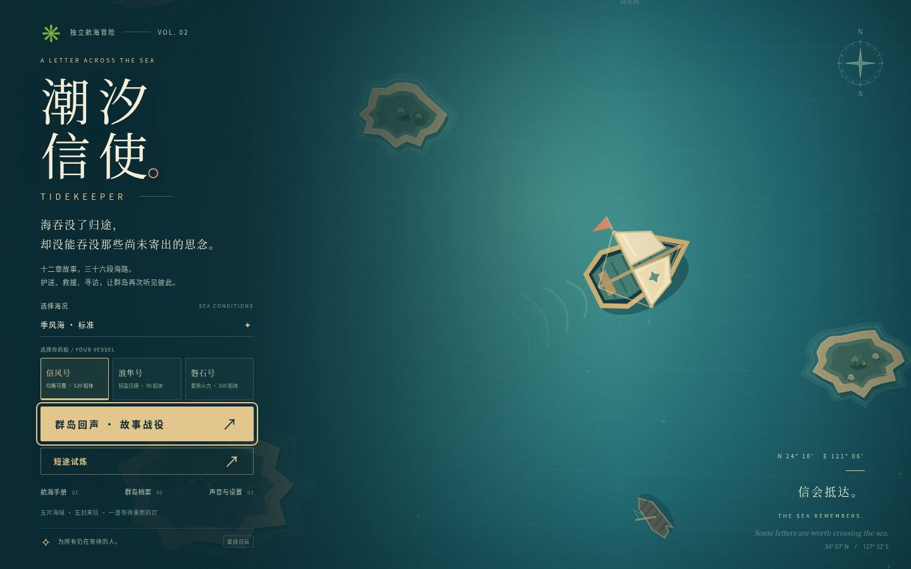
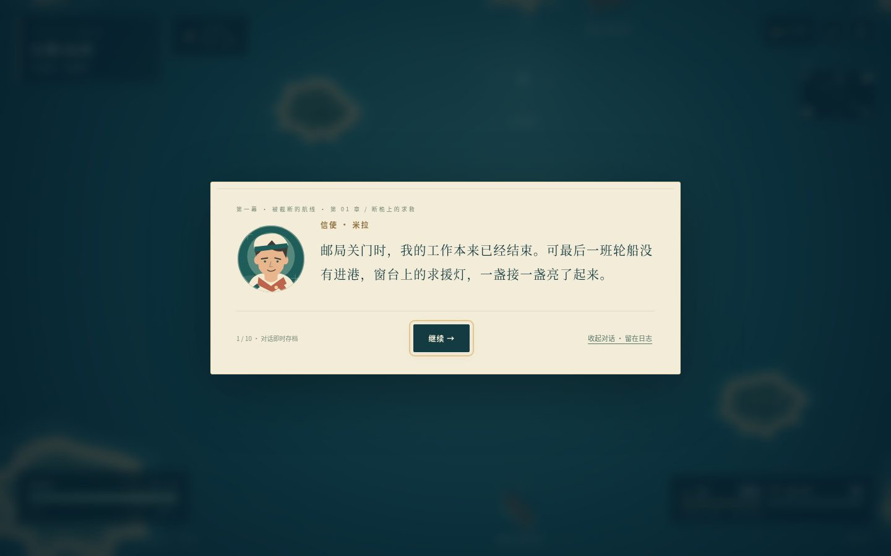

# 浏览器原创游戏

- **[断线协议 · DEAD CIRCUIT](deadcircuit/README.md)**：十八处独立地图的第三人称越肩 3D 多阵营战术枪战，十四款武器与可拆配件、安保与感染者、连续剧情。启动后访问 `/deadcircuit/`。
- **潮汐信使 · 群岛回声**：下方为航海冒险的说明；启动后访问 `/`。

---

# 潮汐信使 · 群岛回声

原创浏览器航海动作冒险。驾驶信舟穿过失联的群岛，调查被篡改的救援航线，在亲人的重逢、旧日责任与海的回声之间，把十二封信送到终点。



## 直接游玩

下载 `dist/tidekeeper.html`，用浏览器打开。美术、角色肖像、音乐、剧情和全部玩法都内置在这一文件中，无需安装运行依赖或下载资源包。

部分浏览器限制本地文件的手柄或存储权限时，可使用 HTTP 启动：

```sh
npm start
```

浏览器访问 `http://localhost:3000`。需要 Node.js 18 或更新版本。`PORT=8080 npm start` 可改变端口。开发入口 `index.html` 需要 HTTP；单文件成品可离线打开。

## 两种完整玩法

**群岛回声 · 故事战役**

- 三幕、十二章、36 段任务，包含 315 条对话、约 1.9 万个中文叙事字及十二封完整信件。
- 救援、打捞、护航、灯塔防守、重舰追猎、浮标航道与四场不同弹幕的首领战。
- 护航敌人会攻击友方船队；靠近并清空周围敌人可维修友船。共鸣可以消除敌弹和预警雷区。
- 每章有两种回应、不同遗物奖励和独立角色对话，选择保留在日志，并汇入双结局。
- 港口航海图、潮贝修理与炮芯整备，任务检查点、对话逐行保存，失败只重试当前航段。
- 为至少一小时的长篇首通设计；阅读速度、探索与重试会改变总时长。可收起对白，完整内容仍保留在日志，跳读会缩短流程。

**短途试炼**

原版五海域动作远航。三艘不同性能的船、三档海况、十二种可叠加遗物、两阶段守望者、沉船打捞、连击、成就、信件档案与本地最高分。适合反复挑战不同搭配。



## 操作

| 操作 | 键鼠 | 标准映射手柄 |
| --- | --- | --- |
| 航行 | WASD / 方向键 | 左摇杆 |
| 无敌闪避 | Space / 左 Shift | A（PlayStation ✕）/ LB |
| 共鸣伤害、清弹与排雷 | E / J / 鼠标右键 | X（PlayStation □）/ RT / RB |
| 手动瞄准 | 按住鼠标左键 | 右摇杆 |
| 暂停 / 继续 | Esc / P | Start / Options |
| 故事日志 | L；暂停菜单也可打开 | 暂停菜单选择日志 |
| 菜单选择 | Tab / 上下方向键 | 左摇杆 / 十字键 |
| 确认 | Enter / Space | A / ✕ |
| 返回 / 剧情暂停 | Esc | B / ○ |

舰炮默认自动瞄准最近的敌人。救援和打捞需要靠近目标停留，并清除目标周围的敌人；可选航海箱提供补给。护送船与灯塔有独立血条，应优先处理攻击它们的黑帆。绿色补给恢复船体，星光用于升级，潮贝用于故事港口整备。

手柄聚焦海况后按 A 循环切换难度。连接后先按任意手柄按钮，让浏览器发现设备。兼容使用浏览器标准 Gamepad API 映射的设备；实际型号由系统与浏览器支持决定。页面失焦和手柄断开会暂停。触屏设备提供方向键和技能键。

## 存档与设置

故事与短途使用独立存档。故事会保存当前章节、任务、船位、剧情行、选择和遗物；暂停时也会保存。通关后可从港口重读完整故事与回信。新故事会替换当前故事存档。

进度保存在当前浏览器的 localStorage，没有账户或云端存档。浏览器禁用存储或空间不足时会明确提示，但仍能游玩。声音需要点击或按键后启用；设置支持静音和减少动态效果。

## 开发与测试

运行时使用原生 ES Modules、Canvas 2D、SVG、Web Audio 和 Gamepad API，不依赖框架或外部 CDN。

```sh
npm ci
npx playwright install chromium
npm test
npm run build
```

开发测试需要 Node.js 20 或更新版本（运行游戏服务器仍可用 Node.js 18）。测试会启动独立服务器，验证两种玩法、12 章与 36 任务的状态流程、首领与结局、存档、失败重试、手柄、触屏和单文件成品。`CHROMIUM_PATH` 可指定浏览器可执行文件。`?test=1` 只在测试页面暴露游戏实例。

自然输入战役流程工具：

```sh
node scripts/campaign-playtest.mjs --output artifacts/campaign-playtest
```

该工具使用普通手柄输入，不改变生命、伤害、任务或游戏时钟；阅读等待明确标为模拟阅读。加速分支测试和短时采样不会被声称为实际一小时通关。

代码：`main.js` 核心战斗与输入；`campaign.js` 故事界面、选择与存档；`campaign-engine.js` 任务；`story.js` 完整长篇剧情；`render.js` 原创美术；`content.js` 短途内容与肖像；`audio.js` 原创程序音乐。

已完成 59 项回归，以及 66 分 35 秒的一轮完整自然输入战役通关（含模拟阅读；12 章、36 项任务）。验证记录与两项后续修复的范围见 `QA.md`，公开证据摘要见 `validation/campaign-playthrough.json`。早期长测记录保留在 `validation/iteration-history.json`；用户已取消十小时发布门槛，旧自动发布流程已停止，历史说明见 `LONG_RUN.md`。
