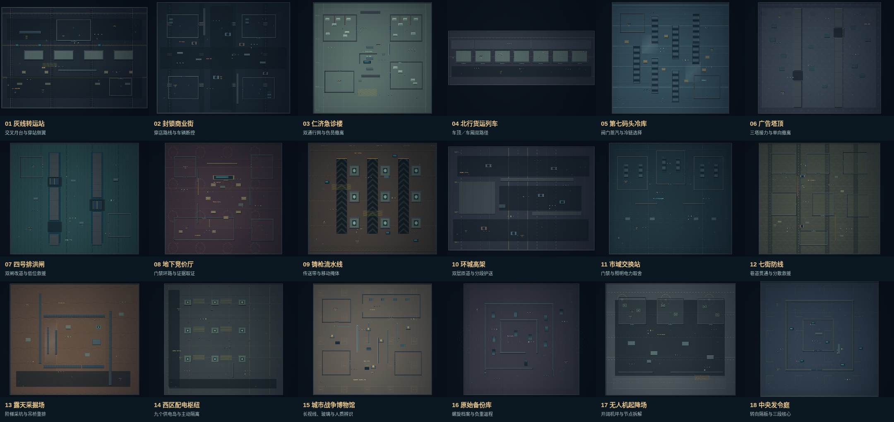
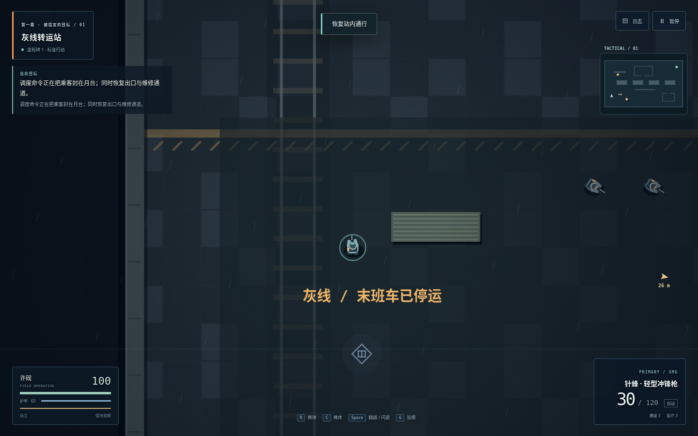
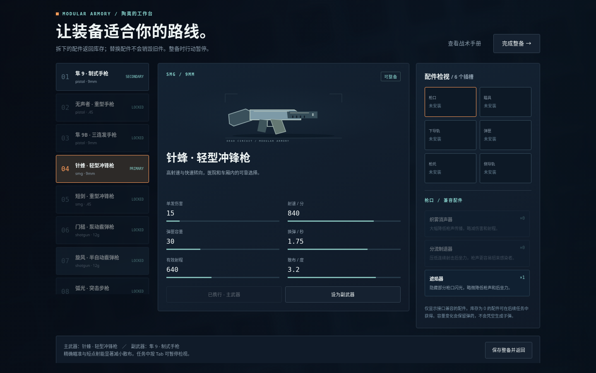

# 断线协议 · DEAD CIRCUIT

独立原创浏览器战术射击。白隼城的敌我识别系统被人改写，感染事故与安保封锁正在互相掩盖。前侦察兵许砚必须和医生、军械师、情报员以及立场分裂的安保指挥官合作，穿过十八处行动区，把人和证据带出封锁线。

## 游玩

运行仓库根目录的 `npm start`，打开 **http://localhost:3000/deadcircuit/**。

`npm run build:deadcircuit` 生成内置全部代码、关卡、美术和音乐的 `dist/deadcircuit.html`。下载后可离线打开；浏览器限制本地文件的手柄或存储权限时，请使用 HTTP 方式。

## 战役

十八张手工布局地图，包含转运站、商业街、急诊楼、行进货列、冷库、广告塔顶、排洪闸、地下竞价厅、铸枪流水线、高架、交换站、住宅防线、采坑、配电枢纽、博物馆、备份库、无人机场和中央发令庭。每张地图有不同的通路、掩体、门禁与主机制。

每关四个行动阶段、八个主目标，并有现场补给、证据与救援支线。开关会实际改变门、危险区域、掩体或敌方设备。已救人员和医疗车会跟随玩家，必须送到安全点；队伍过远会停下等待。守卫和感染者会互相交战，枪声、烟雾和断电能改变局势。

三幕连续剧情、每章抉择、角色来信与三个结局；含 514 条对白、36 份可收集现场文档，正文约 3.9 万个中文叙事字。现场文档可即时收起并在日志中回看。主线和探索按 **2–3 小时首通体验**设计；这是内容与节奏目标，实际时长随阅读速度、路线、整备、难度和是否跳读变化。自动化分支测试不作为真实首通时长。

## 军械与敌人

十四款武器覆盖手枪、冲锋枪、霰弹枪、突击步枪、精确射手步枪、狙击枪、轻机枪和线圈武器。二十八种配件分枪口、瞄具、下导轨、弹匣、枪托和侧轨六槽。拆下的配件回到库存；替换时退还旧件；容量减少时多余弹药回到备弹。消声、容量、精度、后坐力、移动和装填之间有具体取舍。

安保有巡逻、突击、盾兵、狙击、医疗、通讯和重装；感染者有徘徊、疾跑、攀爬、喷吐和重型冲锋；另有无人机、炮塔和两类首领。敌人有视线与声源记忆、换弹、侧翼、预警和有限支援。感染者、安保与机械有可辨认的轮廓与行为。

## 操作

| 动作 | 键鼠 | 标准手柄 |
|---|---|---|
| 移动 / 瞄准 | WASD / 鼠标 | 左 / 右摇杆 |
| 开火 / 精瞄 | 左 / 右鼠标键 | RT / LT |
| 冲刺 | Shift | 按住 L3 |
| 滑步 / 翻越低掩体 | Space | B / ○ |
| 进入 / 离开掩体 | C | RB |
| 蹲伏潜行 | Ctrl | R3 |
| 探身 | 掩体中 Z / X；开火时短暂暴露 | 瞄准与射击时探身 |
| 互动 / 破门 | 按住 F；Shift + F 破锁门 | 按住 A；冲刺 + A 破门 |
| 换弹 / 换枪 | R / Q 或 1、2 | X / Y |
| 投掷 / 切换类型 | G / T | LB / 十字右 |
| 闪光弹 / 医疗 | E / V | 十字左 / 上 |
| 装备 / 日志 / 暂停 | Tab / M 或 L / Esc | 暂停菜单 / View / Start |

触屏左盘移动，画面右侧拖动瞄准并开火，技能使用独立按钮。手柄菜单用左摇杆或十字键选择、A 确认（下拉框循环选项）、B 返回，右摇杆滚动长对白与档案。先按任意手柄键让浏览器识别设备。

## 存档、难度与训练

故事、逐行对白和任务状态自动保存在浏览器 localStorage，与《潮汐信使》独立。失败重试当前阶段，检查点提供最低弹药和医疗保障。窗口失焦、切后台和手柄断开自动暂停。训练场开放所有武器与配件，不覆盖故事进度。

提供剧情、标准和战术三档难度，字幕、大字、减少动态、静音、小地图和摇杆死区设置。所有资源为原创程序绘制、SVG、合成音频或自写中文文本，无远程运行依赖。

## 验证

`npm test` 执行仓库中的两款游戏测试。单独执行 `node --test --test-concurrency=1 deadcircuit/tests/*.test.mjs` 可验证本作。

测试包括地图独立性与可达性、配件和弹药守恒、敌人感知与阵营行为、浏览器 UI、战斗、重试和存档。缩短条件、直接设置位置等测试夹具只用来验证分支，不能声称完成自然时长。当前实测浏览器为 Chromium；标准 Gamepad API 自动输入不等同于实体手柄型号实测。
